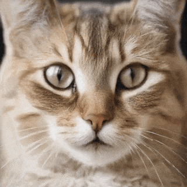
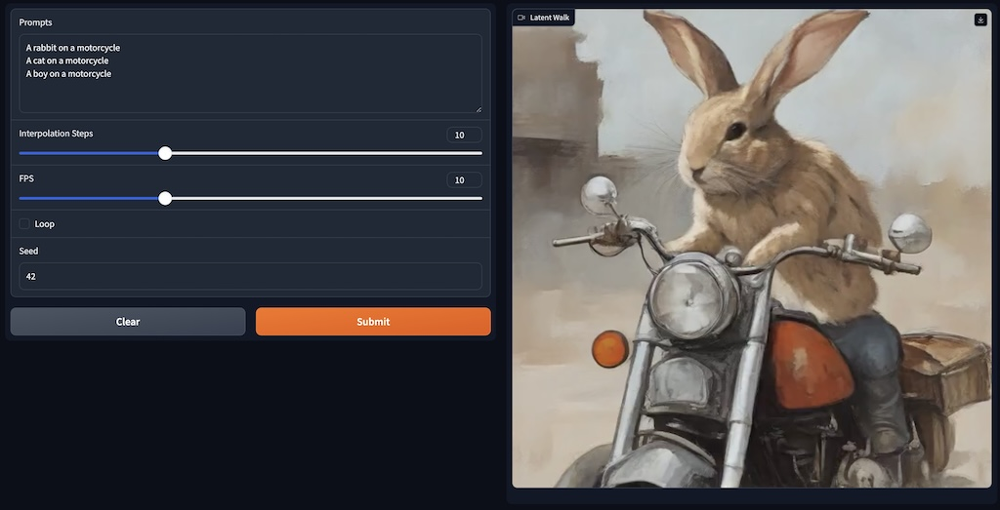
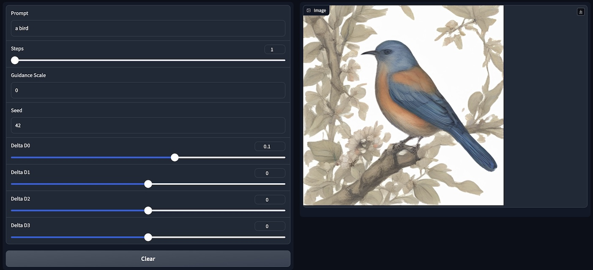

# Diffusion Playground

Experiments with image generation models. The experiments are mainly for
the [SDXL Turbo model](https://huggingface.co/stabilityai/sdxl-turbo), as it is more interesting to play with such a
reactive model.

## Installation

On macOS, use an Apple silicon Mac running macOS 14 or later. Install [uv](https://docs.astral.sh/uv/getting-started/installation/) and FFmpeg with Homebrew, then sync the project.

```sh
brew install uv ffmpeg
uv sync --locked
```

uv uses Python 3.12 for this project. On the first run, Diffusers downloads and caches about 7 GB of SDXL Turbo weights from Hugging Face. PyTorch automatically uses CUDA or Apple Metal (MPS) when available and otherwise uses the CPU.

The Gradio apps print their local URL when the model finishes loading. To make an app reachable on your local network, set `GRADIO_SERVER_NAME=0.0.0.0` when launching it.

## Experiments

### Image Generator

Generate one image from a prompt with adjustable seed, denoising steps, and temperature.

```sh
uv run --locked generate-image-web.py
```

### Denoising Progression

View the initial noise and every step of one SDXL Turbo run in a gallery. Choose one to four denoising steps.

```sh
uv run --locked denoising-progression-web.py
```

### Prompt Latent Walk



Generate latent walks in the prompt latent space.

```
uv run --locked prompt-latent-walk.py
```

### Prompt Latent Walk Web



A webinterface to create latent walks.

```
uv run --locked prompt-latent-walk-web.py
```

### Noise Latent Walk

Initial implementation of initial noise latent walk.

```
uv run --locked noise-latent-walk.py
```

### Latent Explorer Web



Explore the noise latent space with 4 sliders.

```
uv run --locked latent-explorer-web.py
```

## About

Copyright (c) 2024 Florian Bruggisser
